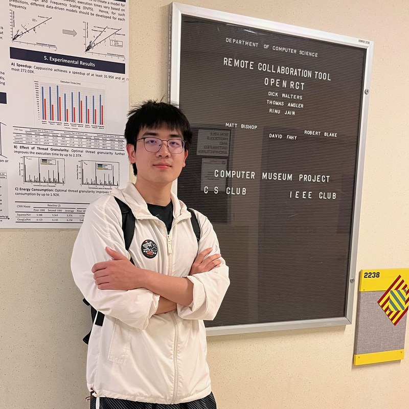

<figure class="hero-figure"><figcaption>Happy times at Kemper Hall, UC Davis, 2023</figcaption></figure>

# Yuu Li [ユウ・リー] [유 이]

Ph.D. Candidate in ECE at GW

I am a second-year Ph.D. candidate supervised by <a href="https://www2.seas.gwu.edu/~tlan/">Prof. Tian Lan</a> and work with <a href="https://sites.google.com/view/statsqizl/">Prof. Zhengling Qi</a>. I do tiny research on LLMs, mainly exploring the internal mechanisms of LLM training and inference and performing attribution-based optimization.

ResearchLLM Reasoning · Agentic Systems · Vision and Control

  <a href="../file/CV_Yu_Li.pdf">CV</a>
  <a href="https://github.com/skylanding" target="_blank" rel="noopener">GitHub</a>
  <a href="https://scholar.google.com/citations?user=EjGk0dwAAAAJ&hl=en" target="_blank" rel="noopener">Google Scholar</a>
  <a href="https://www.linkedin.com/in/yu-li-a089a6282/" target="_blank" rel="noopener">LinkedIn</a>

## Education

  
<strong>George Washington University</strong>, Washington, D.C.
Ph.D. in Electrical and Computer Engineering · GPA 4.0/4.0

  2025.9 – 2029.5 (expected)

  
<strong>Wuhan University</strong>, Hongyi Honor College, China
B.Eng. in Microelectronics Science and Technology · GPA 3.87/4.0

  2021.9 – 2025.5

---

## News

- **[09/2026]** OPPO and InsPO are accepted to NeurIPS 2026 🎉. See you in Sydney.
- **[07/2026]** MomentKV is accepted to COLM 2026 🎉. See you in San Francisco.
- **[06/2026]** I started serving as a reviewer for the TMLR.
- **[05/2026]** I will join ByteDance as a Research Scientist Intern in San Jose from May to August 🚀.
- **[02/2026]** CRAFT-LORA is accepted to CVPR 2026 🎉.

---

## Selected Publications

  <strong>OPPO: Bayesian Value Recursion for Token-Level Credit Assignment in LLM Reasoning</strong> 
  

    <b>Yu Li</b>, Rui Miao, Tian Lan, Zhengling Qi
  

  <i>NeurIPS 2026</i> · <a href="https://arxiv.org/abs/2605.21851" target="_blank" rel="noopener">Paper</a>

  <strong>InsPO: Unlocking Intrinsic Self-Reflection for LLM Preference Optimization</strong> 
  

    <b>Yu Li</b>, Tian Lan, Zhengling Qi
  

  <i>NeurIPS 2026</i> · <a href="https://arxiv.org/abs/2512.23126" target="_blank" rel="noopener">Paper</a> · <a href="https://github.com/Skylanding/InsPO" target="_blank" rel="noopener">Code</a>

  <strong>MomentKV: Closing the Directional Gap in KV Cache Eviction for Long-Context Inference</strong> 
  

    <b>Yu Li</b>, Binxu Li, Tian Lan
  

  <i>COLM 2026</i> · <a href="https://arxiv.org/abs/2606.01563" target="_blank" rel="noopener">Paper</a>

  <strong>CRAFT-LoRA: Content-Style Personalization via Rank-Constrained Adaptation and Training-Free Fusion</strong> 
  

    <b>Yu Li</b>, Yujun Cai, Chi Zhang
  

  <i>CVPR 2026</i> · <a href="https://arxiv.org/abs/2602.18936" target="_blank" rel="noopener">Paper</a> · <a href="https://github.com/Skylanding/CraftLoRA" target="_blank" rel="noopener">Code</a>

  <strong>Calibrating and Rotating: A Unified Framework for Weight Conditioning in PEFT</strong> 
  

    Chang Da, Peng Xue, <b>Yu Li</b>, Yongxiang Liu, Pengxiang Xu, Shixun Zhang
  

  <i>AAAI 2026</i> · <a href="https://arxiv.org/abs/2511.00051" target="_blank" rel="noopener">Paper</a> · <a href="https://github.com/MaeChd/SORA" target="_blank" rel="noopener">Code</a>

For the full list of publications, please see my <a href="https://scholar.google.com/citations?user=EjGk0dwAAAAJ&hl=en" target="_blank" rel="noopener">Google Scholar</a>.

---

## Experiences

  <strong>Mobile Intelligence Lab, George Washington University</strong>
  

    Research Topic: Post-training, RL, Reasoning
  

  Advisor: Prof. Tian Lan · Aug. 2025 – Present

  <strong>Artificial General Intelligence Lab, Westlake University</strong>
  

    Research Topic: Generative AI
  

  Advisor: Prof. Chi Zhang · Mar. 2025 – Jul. 2025

  <strong>Cyber-Physical Systems Lab, UC Irvine</strong>
  

    Research Topic: Multimodal Uncertainty Fusion
  

  Advisor: Prof. Mohammad Al Faruque · Jun. 2024 – Oct. 2024

  <strong>GREAT Summer Research Program, UC Davis</strong>
  

    Research Topic: Deep Learning for Healthcare
  

  Advisor: Prof. Weijian Yang · Jul. 2023 – Oct. 2023

---

## Honors and Awards

- ICML 2026 Gold Reviewer (Top Reviewers Recognition), 2026
- Innova International Exchange Scholarship, Wuhan University, 2024
- Innova Excellence Scholarship (Top 3%), Wuhan University, 2023, 2024
- Academic Excellence Scholarship (Top 5%), Hongyi Honor College, 2022, 2023, 2024
- First-Class Scholarship (Top 5%), Wuhan University, 2022, 2023, 2024
- Patent: Energy-saving calculation method, <a href="https://patents.google.com/patent/CN116085952B/en">CN116085952</a>.

---

## Academic Services

The peer review mechanism is breaking down, but conscientious peer review endures:

- **Conference Reviewer:** NeurIPS’26, COLM’26, ACM MM’26, ICML’26, ICLR’26, AAAI’26, ICASSP’26
- **Journal Reviewer:** TMLR, TPAMI, ToN, Neurocomputing

---

## Fun Facts

- I am a Pokémon fan. 
- I love walking and hiking.
- My favorite animal is our family cat, dd. She likes it when I pat her head. 

This website was stolen from my <a href="https://maechd.github.io/">best friend CD.</a>
