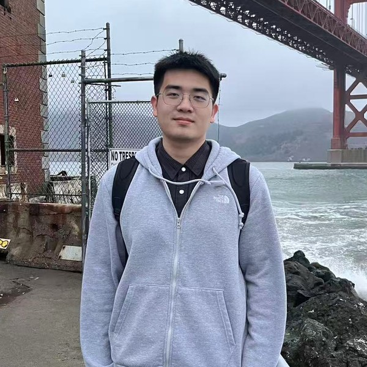

# 李煜 (Yuu Li) ユウ・リー · Юу Ли · 유 이

乔治·华盛顿大学 ECE 博士候选人

我目前是二年级博士候选人，导师是 <a href="https://www2.seas.gwu.edu/~tlan/">Tian Lan</a> 教授，并与 <a href="https://sites.google.com/view/statsqizl/">Zhengling Qi</a> 教授合作。

研究方向LLM 后训练 · 智能体策略学习 · 生成式 AI

  <a href="../file/CV_Yu_Li.pdf">简历</a>
  <a href="https://github.com/skylanding" target="_blank" rel="noopener">GitHub</a>
  <a href="https://scholar.google.com/citations?user=EjGk0dwAAAAJ&hl=en" target="_blank" rel="noopener">谷歌学术</a>
  <a href="https://www.linkedin.com/in/yu-li-a089a6282/" target="_blank" rel="noopener">领英</a>

## 教育经历 (Education)

  
<strong>乔治·华盛顿大学 (George Washington University)</strong>，华盛顿特区
电子与计算机工程系 (ECE) 博士 · GPA 4.0/4.0

  2025.9 – 2029.5（预计）

  
<strong>武汉大学 (Wuhan University)</strong>，弘毅学堂，中国武汉
微电子科学与技术 工学学士 · GPA 3.87/4.0

  2021.9 – 2025.5

---

## 近期动态 (News)

- **[09/2026]** OPPO 和 InsPO 被 NeurIPS 2026 接收 🎉. 悉尼见！
- **[07/2026]** MomentKV 被 COLM 2026 录取 🎉. 旧金山见！
- **[06/2026]** 开始担任 TMLR 审稿人。
- **[05/2026]** 加入 ByteDance 担任研究科学家实习生，坐标圣何塞，5月至8月 🚀.
- **[02/2026]** CRAFT-LORA 被 CVPR 2026 接收 🎉. 6月丹佛见！

---

## 代表性论文 (Selected Publications)

### 预印本 / 在投 (Preprint / Under Review)

  <strong>ARISE: Agent Reasoning with Intrinsic Skill Evolution in Hierarchical Reinforcement Learning</strong> 
  

    <b>Yu Li</b>, Rui Miao, Zhengling Qi, Tian Lan
  

  在投 · <a href="https://arxiv.org/abs/2603.16060" target="_blank" rel="noopener">论文</a> · <a href="https://github.com/Skylanding/ARISE" target="_blank" rel="noopener">代码</a>

  <strong>Right Meets Wrong: Bilateral Context Conditioning with Reward-Confidence Correction for GRPO</strong> 
  

    <b>Yu Li</b>, Tian Lan, Zhengling Qi
  

  在投 · <a href="https://arxiv.org/abs/2603.13134" target="_blank" rel="noopener">论文</a> · <a href="https://github.com/Skylanding/BiCC" target="_blank" rel="noopener">代码</a>

### 会议论文 (Conferences)

  <strong>OPPO: Bayesian Value Recursion for Token-Level Credit Assignment in LLM Reasoning</strong> 
  

    <b>Yu Li</b>, Rui Miao, Tian Lan, Zhengling Qi
  

  <i>NeurIPS 2026</i> · <a href="https://arxiv.org/abs/2605.21851" target="_blank" rel="noopener">论文</a>

  <strong>InsPO: Unlocking Intrinsic Self-Reflection for LLM Preference Optimization</strong> 
  

    <b>Yu Li</b>, Tian Lan, Zhengling Qi
  

  <i>NeurIPS 2026</i> · <a href="https://arxiv.org/abs/2512.23126" target="_blank" rel="noopener">论文</a> · <a href="https://github.com/Skylanding/InsPO" target="_blank" rel="noopener">代码</a>

  <strong>MomentKV: Closing the Directional Gap in KV Cache Eviction for Long-Context Inference</strong> 
  

    <b>Yu Li</b>, Binxu Li, Tian Lan
  

  <i>COLM 2026</i> · <a href="https://arxiv.org/abs/2606.01563" target="_blank" rel="noopener">论文</a>

  <strong>Reason in Chains, Learn in Trees: Self-Rectification and Grafting for Multi-turn Agent Policy Optimization</strong> 
  

    <b>Yu Li</b>, Sizhe Tang, Tian Lan
  

  <i>ACL Findings 2026</i>

  <strong>CRAFT-LoRA: Content-Style Personalization via Rank-Constrained Adaptation and Training-Free Fusion</strong> 
  

    <b>Yu Li</b>, Yujun Cai, Chi Zhang
  

  <i>CVPR 2026</i> · <a href="https://arxiv.org/abs/2602.18936" target="_blank" rel="noopener">论文</a> · <a href="https://github.com/Skylanding/CraftLoRA" target="_blank" rel="noopener">代码</a> 

  <strong>KG-SAM: Injecting Anatomical Knowledge into Segment Anything Models via Conditional Random Fields</strong> 
  

    <b>Yu Li</b>, Chang Da, Xi Xiao
  

  <i>ICASSP 2026</i> · <b>Oral</b> · <a href="https://arxiv.org/abs/2509.21750" target="_blank" rel="noopener">论文</a>

  <strong>Calibrating and Rotating: A Unified Framework for Weight Conditioning in PEFT</strong> 
  

    Chang Da, Peng Xue, <b>Yu Li</b>, Yongxiang Liu, Pengxiang Xu, Shixun Zhang
  

  <i>AAAI 2026</i> · <a href="https://arxiv.org/abs/2511.00051" target="_blank" rel="noopener">论文</a> · <a href="https://github.com/MaeChd/SORA" target="_blank" rel="noopener">代码</a>

---

## 科研经历 (Experiences)

  <strong>乔治·华盛顿大学, 移动智能实验室</strong>
  

    研究课题: 训练后优化, 强化学习, 推理
  

  导师: Prof. Tian Lan · 2025年8月 – 至今

  <strong>西湖大学, 人工通用智能实验室</strong>
  

    研究课题: 生成式AI
  

  导师: Prof. Chi Zhang · 2025年3月 – 2025年7月

  <strong>加州大学尔湾分校, 信息物理系统实验室</strong>
  

    研究课题: 多模态不确定性融合
  

  导师: Prof. Mohammad Al Faruque · 2024年6月 – 2024年10月

---

## 荣誉奖项 (Honors and Awards)

- ICML 2026 金牌审稿人 (Top Reviewers Recognition)，2026
- 英诺国际交流奖学金，武汉大学，2024
- 英诺卓越奖学金（Top 3%），武汉大学，2023，2024
- 学术优秀奖学金（Top 5%），弘毅学堂，2022，2023，2024
- 甲等奖学金（Top 5%），武汉大学，2022，2023，2024
- 专利: 一种节能计算方法, <a href="https://patents.google.com/patent/CN116085952B/en">CN116085952</a>.

---

## 学术服务 (Academic Services)

审稿机制正在崩坏，但认真的审稿仍在继续：

- **会议审稿人:** NeurIPS’26, COLM’26, ACM MM’26, ICML’26, ICLR’26, AAAI’26, ICASSP’26
- **期刊审稿人:** TMLR, TPAMI, ToN, Neurocomputing

这个网站模版是从我<a href="https://maechd.github.io/">最好的朋友</a>那里偷来的。
